<p align="center">
  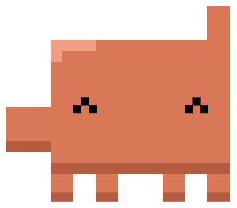
</p>

<h1 align="center">llm-pet</h1>

<p align="center">
  A pixel Clawd that lives on your macOS desktop and tells you what your LLM is up to.<br><br>
  <a href="https://github.com/Swiezu/llm-pet/actions/workflows/ci.yml"></a>
  
  
  <a href="https://github.com/Swiezu/llm-pet/releases/latest"></a>
  <a href="LICENSE"></a>
</p>

The pet sits in a transparent always-on-top window on every Space. It shows messages in speech bubbles (every channel has its own color) and plays animations on demand: from the menu bar, through a local API, from an SDK or straight from an LLM over MCP. On its own it just stands and blinks, so it never gets in the way.

> An unofficial fan project, not affiliated with Anthropic.

## Animations

<table>
<tr><td align="center">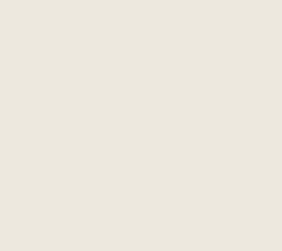<br><b>Teleport</b> <code>teleport</code><br><sub>portal entrance, hard landing, greeting</sub></td><td align="center"><br><b>Walk</b> <code>walk</code><br><sub>strolls to a chosen spot</sub></td><td align="center">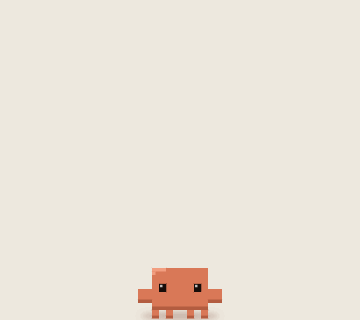<br><b>Hops</b> <code>hop</code><br><sub>a series of tilted hops</sub></td></tr>
<tr><td align="center">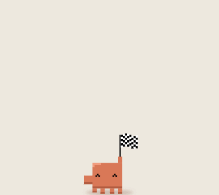<br><b>Flag</b> <code>flag</code><br><sub>checkered flag, marching in place</sub></td><td align="center">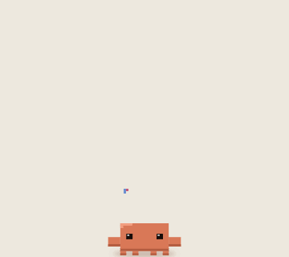<br><b>Party</b> <code>party</code><br><sub>squats and confetti</sub></td><td align="center">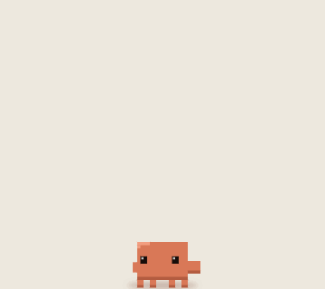<br><b>Workout</b> <code>workout</code><br><sub>headband, dumbbells, presses</sub></td></tr>
<tr><td align="center">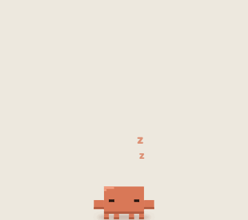<br><b>Sleep</b> <code>sleep</code><br><sub>breathing and floating “z”</sub></td><td align="center">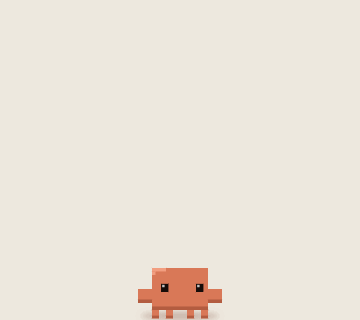<br><b>Typing</b> <code>typing</code><br><sub>keyboard slam, very fast typing</sub></td><td align="center">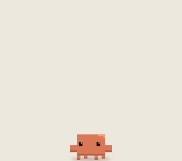<br><b>Dilly-dallying</b> <code>dillydally</code><br><sub>wandering, pebble kick, humming</sub></td></tr>
<tr><td align="center">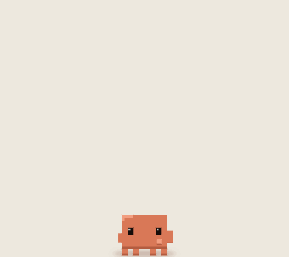<br><b>Lock in</b> <code>lockin</code><br><sub>deep focus, aura, light bulb</sub></td><td align="center">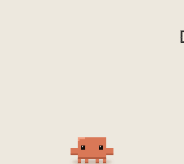<br><b>Letter</b> <code>letter</code><br><sub>catches a fluttering letter and reads it</sub></td><td align="center">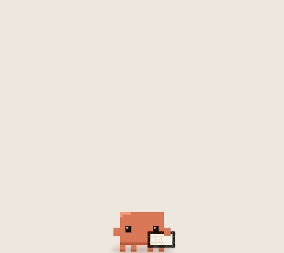<br><b>Paper plane</b> <code>plane</code><br><sub>folds and throws a paper plane</sub></td></tr>
<tr><td align="center">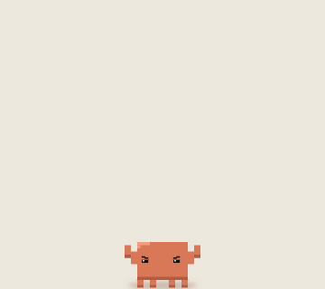<br><b>Kamehameha</b> <code>kamehameha</code><br><sub>energy ball and beam</sub></td><td align="center">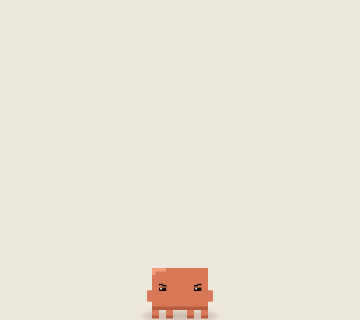<br><b>Power up</b> <code>powerup</code><br><sub>flame aura, golden hair</sub></td><td align="center">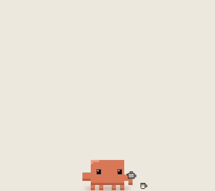<br><b>Coffee</b> <code>coffee</code><br><sub>pours, blows, sips</sub></td></tr>
<tr><td align="center">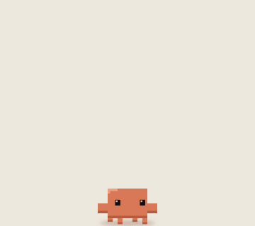<br><b>Buffering</b> <code>buffering</code><br><sub>spinner, lag spikes, catching up</sub></td><td align="center">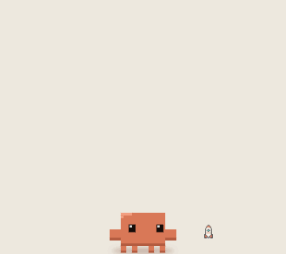<br><b>Deploy to prod</b> <code>deploy</code><br><sub>countdown and rocket launch</sub></td><td align="center">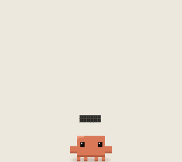<br><b>Context full</b> <code>contextfull</code><br><sub>buried in tokens, bar goes red</sub></td></tr>
<tr><td align="center">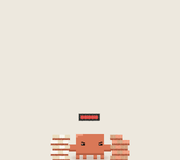<br><b>Compact</b> <code>compact</code><br><sub>stomps tokens into a packed cube</sub></td><td align="center">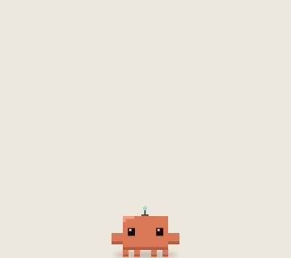<br><b>Hello fellow AI</b> <code>helloai</code><br><sub>antenna, LED eyes, signals</sub></td><td align="center">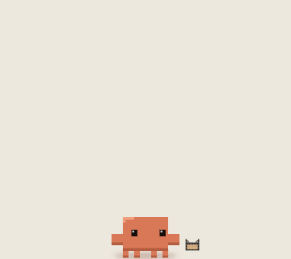<br><b>Ship it!</b> <code>shipit</code><br><sub>box, ✓ and a little ship</sub></td></tr>
<tr><td align="center">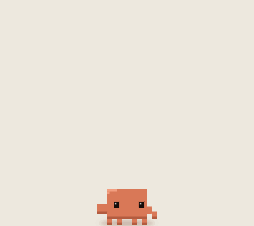<br><b>Smoke break</b> <code>smoke</code><br><sub>lights up, smoke rings, stomps the butt</sub></td><td align="center">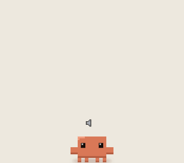<br><b>Muted</b> <code>mute</code><br><sub>speaker crossed out, zips its mouth (plays when a channel is muted)</sub></td><td align="center">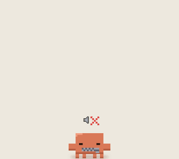<br><b>Unmuted</b> <code>unmute</code><br><sub>unzips, sound waves and singing (plays when a channel is unmuted)</sub></td></tr>
<tr><td align="center"><br><b>Chill</b> <code>chill</code><br><sub>rolls a thick one, lights it, big clouds, red eyes and giggles</sub></td><td align="center">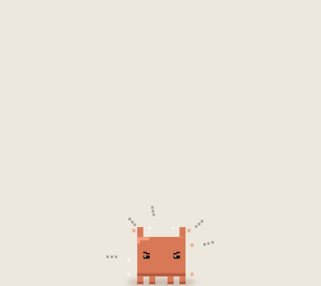<br><b>Resize</b><br><sub>pet size slider in the settings: strains and grows, squeezes and shrinks</sub></td><td align="center">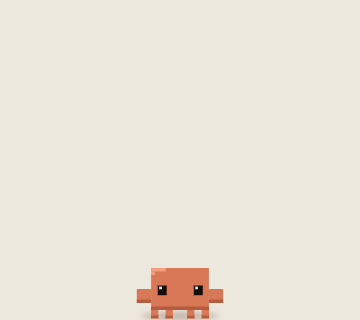<br><b>Lunch break</b> <code>lunch</code><br><sub>tummy growls, a burger in four bites, soda, burp</sub></td></tr>
</table>

Every animation uses the same sprite on a shared pixel grid; props (portal, mug, rocket, box…) are pixel art in the same style.

## Features

- **Speech bubbles with channels**: a main channel plus as many as you like, each with its own name and color; text types itself out, bubbles keep to the screen edges.
- **Queue**: up to 2 bubbles stacked above the pet, the rest wait their turn and a "+n" badge shows how many.
- **Duration and links**: every bubble has an X in the corner, with a ring around it counting down until the bubble disappears; `seconds: 0` keeps it until you click X; an optional link (URL, deep link or file path) at the bottom right opens on click.
- **Long messages**: line breaks are kept; text taller than the bubble gets "more", which smoothly expands it to the full text (up to twice as wide, scrollable when it does not fit on screen), pauses the countdown and shows X; "less" collapses it and the countdown resumes.
- **Muting only by the user** (settings, menu bar or the right-click menu on the pet), so neither an LLM nor another app can get around it; Clawd plays a mute or unmute animation.
- **27 animations** triggered from the menu, the API, an SDK or MCP; clicking the pet plays a random trick; animation speed, a fast mode and an animations off switch.
- **Right-click menu**: right-clicking the pet opens the same menu as the menu bar paw.
- **Drag and drop**: grab the pet and move it; on release it settles right where you left it, and it remembers the spot after hiding or quitting.
- **English and Polish** UI, chosen on first launch.
- **Settings**: language, channels, pet size (50-200%, animated live), bubble text size, max bubble width and height, animation speed (normal and fast mode), frame rate separately on power and on battery (15, 30, 60, 120, 144… up to what the display supports, or VSync).
- **Local HTTP API** on `127.0.0.1` only, token protected, with JS, Swift and shell SDKs and an MCP server.
- **DEBUG menu** to preview animations, texts and channel colors.

## Install

### Prebuilt app
1. Download `llm-pet.zip` from [Releases](https://github.com/Swiezu/llm-pet/releases) (or from the artifacts of the latest [CI run](https://github.com/Swiezu/llm-pet/actions)).
2. Unzip it and move `llm-pet.app` to `/Applications`.
3. The app is ad hoc signed, so clear the quarantine flag once:
   ```bash
   xattr -dr com.apple.quarantine /Applications/llm-pet.app
   ```
4. Launch it, pick a language, and look for the paw in the menu bar.

### From source
Requires macOS 26+ and Swift 6.2+ (Xcode or Command Line Tools).
```bash
git clone https://github.com/Swiezu/llm-pet.git && cd llm-pet
macos/build.sh --open        # release build into build/llm-pet.app, then launch
```

## Usage

| menu bar (paw) or right-click on the pet | what it does |
|---|---|
| Show / Hide pet | showing starts with the teleport |
| Settings… (⌘,) | language, channels (name, color, mute, delete), pet size, bubble text size, max bubble width and height, animation speed, VSync, frame rate on power and on battery |
| Animations / Fast mode | switches: animations off (the pet just stands still), fast mode (the fast speed from the settings) |
| Channels | one switch per channel: on = shown, off = muted |
| DEBUG ANIMATION / TEXT / CHANNEL | preview animations, texts and channel colors |
| Quit (⌘Q) | |

### From an LLM (MCP)
```bash
git clone https://github.com/Swiezu/llm-pet.git && cd llm-pet && npm install
claude mcp add llm-pet -- node "$PWD/mcp/server.mjs"
```
Tools: `pet_say` (bubble, optional channel, animation, duration and link), `pet_action`, `pet_actions`, `pet_channels`, `pet_add_channel`, `pet_remove_channel`, `pet_status`. Details in [`mcp/README.md`](mcp/README.md).

### From the terminal and scripts
```bash
sdk/shell/llm-pet say "Build is green" -c Build -a shipit
sdk/shell/llm-pet say "Review needed" -s 0 -l https://github.com/Swiezu/llm-pet/pulls
sdk/shell/llm-pet action deploy
sdk/shell/llm-pet channel-add Build "#3B4A6B"
```

### From other apps
```swift
import LlmPetKit
try await LlmPet().say("Done!", channel: "Build", animation: "party")
```
```bash
npm install /path/to/llm-pet/sdk/js
```
```js
import { say } from '@swiezu/llm-pet-sdk'
await say('Done!', { channel: 'Build', animation: 'party' })
```
Full API and client reference: [`sdk/README.md`](sdk/README.md).

## How it works

```
LLM ── MCP ──> mcp/server.mjs ─┐
other apps ── sdk/swift, js ───┼── HTTP 127.0.0.1 + token ──> llm-pet.app ──> bubble / animation
scripts ── sdk/shell ──────────┘
```
On launch the app writes its port and a one-time token to `~/Library/Application Support/llm-pet/server.json` (mode 0600); clients read it on their own.

## Development

| directory | what |
|---|---|
| [`macos/`](macos/README.md) | the app (Swift package, AppKit + SwiftUI) |
| [`sdk/`](sdk/README.md) | API reference and clients: JS (`@swiezu/llm-pet-sdk`), Swift (`LlmPetKit`), shell |
| [`mcp/`](mcp/README.md) | MCP server (`@swiezu/llm-pet-mcp`, Node, stdio) |
| `docs/` | logo and animation GIFs for this README |

```bash
npm install && npm test                            # JS SDK and MCP (npm workspaces)
swift build --package-path macos
macos/.build/debug/llm-pet --dump-frames frames   # frame sheets for every animation (PNG)
macos/.build/debug/llm-pet --render-docs docs     # logo and GIFs for this README
```
Adding an animation is described in [`macos/README.md`](macos/README.md#new-animation). CI (GitHub Actions) builds the app and the Swift SDK on macOS, runs the JS SDK and MCP tests, and after every green push to `main` tags a new version on its own and creates a GitHub release with `llm-pet.zip`. The JS SDK and the MCP server are not published to npm; they are used straight from the repository.

Versions follow the commits since the last tag: `feat:` bumps the minor version, `!` or `BREAKING CHANGE` bumps the major version, anything else bumps the patch version; `[skip release]` in the commit message skips the release.

## License

[MIT](LICENSE)
