<p align="center">
  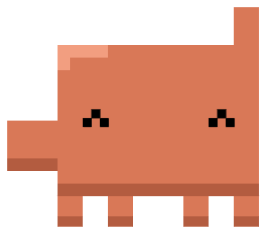
</p>

<h1 align="center">llm-pet</h1>

<p align="center">
  A pixel Clawd that lives on your macOS desktop and tells you what your LLM is up to.<br><br>
  <a href="https://github.com/Swiezu/llm-pet/actions/workflows/ci.yml"></a>
  
  
  <a href="LICENSE"></a>
</p>

The pet sits in a transparent always-on-top window on every Space. It shows messages in speech bubbles (every channel has its own color) and plays animations on demand: from the menu bar, through a local API, from an SDK or straight from an LLM over MCP. On its own it just stands and blinks, so it never gets in the way.

> An unofficial fan project, not affiliated with Anthropic.

## Animations

<table>
<tr><td align="center">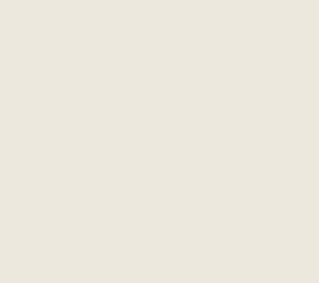<br><b>Teleport</b> <code>teleport</code><br><sub>portal entrance, hard landing, greeting</sub></td><td align="center"><br><b>Walk</b> <code>walk</code><br><sub>strolls to a chosen spot</sub></td><td align="center">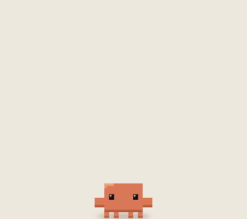<br><b>Hops</b> <code>hop</code><br><sub>a series of tilted hops</sub></td></tr>
<tr><td align="center">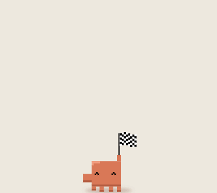<br><b>Flag</b> <code>flag</code><br><sub>checkered flag, marching in place</sub></td><td align="center">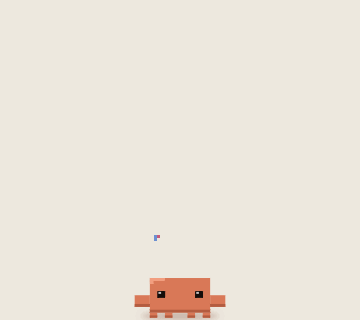<br><b>Party</b> <code>party</code><br><sub>squats and confetti</sub></td><td align="center">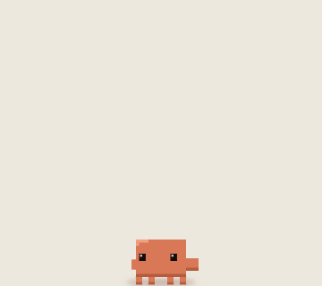<br><b>Workout</b> <code>workout</code><br><sub>headband, dumbbells, presses</sub></td></tr>
<tr><td align="center">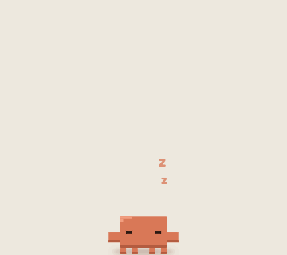<br><b>Sleep</b> <code>sleep</code><br><sub>breathing and floating “z”</sub></td><td align="center">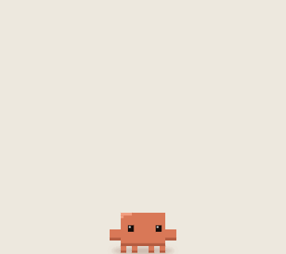<br><b>Typing</b> <code>typing</code><br><sub>keyboard slam, very fast typing</sub></td><td align="center">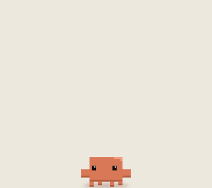<br><b>Dilly-dallying</b> <code>dillydally</code><br><sub>wandering, pebble kick, humming</sub></td></tr>
<tr><td align="center">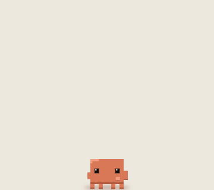<br><b>Lock in</b> <code>lockin</code><br><sub>deep focus, aura, light bulb</sub></td><td align="center">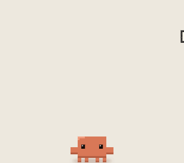<br><b>Letter</b> <code>letter</code><br><sub>catches a fluttering letter and reads it</sub></td><td align="center">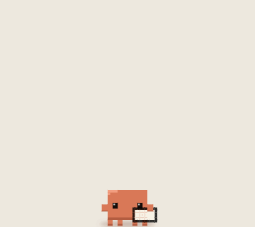<br><b>Paper plane</b> <code>plane</code><br><sub>folds and throws a paper plane</sub></td></tr>
<tr><td align="center">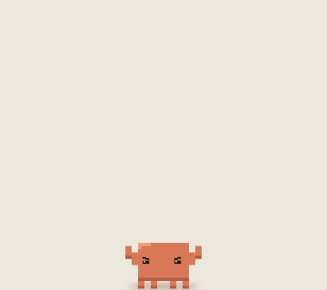<br><b>Kamehameha</b> <code>kamehameha</code><br><sub>energy ball and beam</sub></td><td align="center">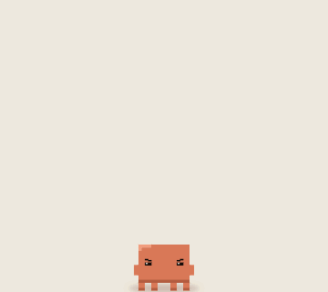<br><b>Power up</b> <code>powerup</code><br><sub>flame aura, golden hair</sub></td><td align="center">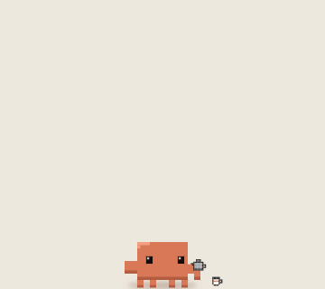<br><b>Coffee</b> <code>coffee</code><br><sub>pours, blows, sips</sub></td></tr>
<tr><td align="center">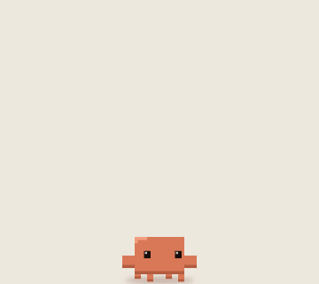<br><b>Buffering</b> <code>buffering</code><br><sub>spinner, lag spikes, catching up</sub></td><td align="center">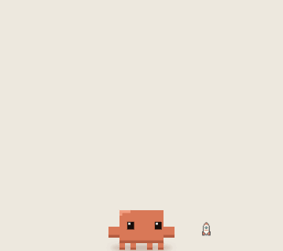<br><b>Deploy to prod</b> <code>deploy</code><br><sub>countdown and rocket launch</sub></td><td align="center">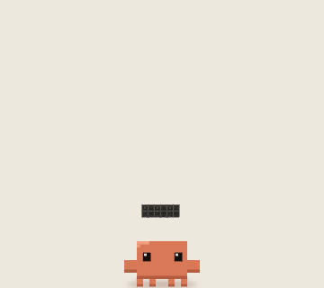<br><b>Context full</b> <code>contextfull</code><br><sub>buried in tokens, bar goes red</sub></td></tr>
<tr><td align="center">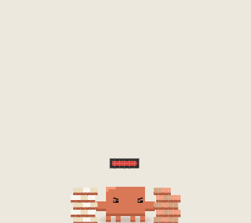<br><b>Compact</b> <code>compact</code><br><sub>stomps tokens into a packed cube</sub></td><td align="center">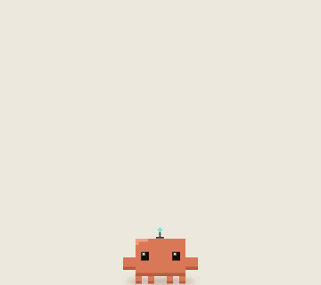<br><b>Hello fellow AI</b> <code>helloai</code><br><sub>antenna, LED eyes, signals</sub></td><td align="center">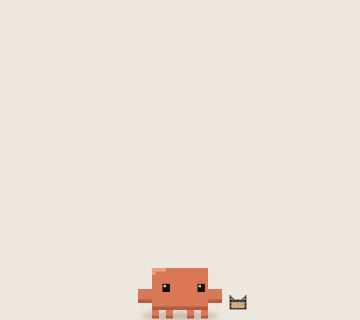<br><b>Ship it!</b> <code>shipit</code><br><sub>box, ✓ and a little ship</sub></td></tr>
</table>

Every animation uses the same sprite on a shared pixel grid; props (portal, mug, rocket, box…) are pixel art in the same style.

## Features

- **Speech bubbles with channels**: a main channel plus as many as you like, each with its own name and color; text types itself out, bubbles keep to the screen edges.
- **Muting only from the app settings**, so neither an LLM nor another app can get around it.
- **22 animations** triggered from the menu, the API, an SDK or MCP; clicking the pet plays a random trick.
- **Drag and drop**: grab the pet and move it; on release it settles right where you left it.
- **English and Polish** UI, chosen on first launch.
- **Settings**: language, channels and frame rate (12-120 fps).
- **Local HTTP API** on `127.0.0.1` only, token protected, with JS, Swift and shell SDKs and an MCP server.
- **DEBUG menu** to preview animations, texts and channel colors.

## Install

### Prebuilt app
1. Download `llm-pet.zip` from [Releases](https://github.com/Swiezu/llm-pet/releases) (or from the artifacts of the latest [CI run](https://github.com/Swiezu/llm-pet/actions)).
2. Unzip it and move `llm-pet.app` to `/Applications`.
3. The app is ad hoc signed, so clear the quarantine flag once:
   ```bash
   xattr -dr com.apple.quarantine /Applications/llm-pet.app
   ```
4. Launch it, pick a language, and look for the paw in the menu bar.

### From source
Requires macOS 26+ and Swift 6.2+ (Xcode or Command Line Tools).
```bash
git clone https://github.com/Swiezu/llm-pet.git && cd llm-pet
macos/build.sh --open        # release build into build/llm-pet.app, then launch
```

## Usage

| menu bar (paw) | what it does |
|---|---|
| Show / Hide pet | showing starts with the teleport |
| Settings… (⌘,) | language, channels (name, color, mute, delete) and frame rate |
| DEBUG ANIMATION / TEXT / CHANNEL | preview animations, texts and channel colors |
| Quit (⌘Q) | |

### From an LLM (MCP)
```bash
cd mcp && npm install
claude mcp add llm-pet -- node "$PWD/server.mjs"
```
Tools: `pet_say` (bubble, optional channel and animation), `pet_action`, `pet_actions`, `pet_channels`, `pet_add_channel`, `pet_remove_channel`, `pet_status`. Details in [`mcp/README.md`](mcp/README.md).

### From the terminal and scripts
```bash
sdk/shell/llm-pet say "Build is green" -c Build -a shipit
sdk/shell/llm-pet action deploy
sdk/shell/llm-pet channel-add Build "#3B4A6B"
```

### From other apps
```swift
import LlmPetKit
try await LlmPet().say("Done!", channel: "Build", animation: "party")
```
```js
import { say } from 'llm-pet-sdk'
await say('Done!', { channel: 'Build', animation: 'party' })
```
Full API and client reference: [`sdk/README.md`](sdk/README.md).

## How it works

```
LLM ── MCP ──> mcp/server.mjs ─┐
other apps ── sdk/swift, js ───┼── HTTP 127.0.0.1 + token ──> llm-pet.app ──> bubble / animation
scripts ── sdk/shell ──────────┘
```
On launch the app writes its port and a one-time token to `~/Library/Application Support/llm-pet/server.json` (mode 0600); clients read it on their own.

## Development

| directory | what |
|---|---|
| [`macos/`](macos/README.md) | the app (Swift package, AppKit + SwiftUI) |
| [`sdk/`](sdk/README.md) | API reference and clients: JS, Swift (`LlmPetKit`), shell |
| [`mcp/`](mcp/README.md) | MCP server (Node, stdio) |
| `docs/` | logo and animation GIFs for this README |

```bash
swift build --package-path macos
macos/.build/debug/llm-pet --dump-frames frames   # frame sheets for every animation (PNG)
macos/.build/debug/llm-pet --render-docs docs     # logo and GIFs for this README
```
Adding an animation is described in [`macos/README.md`](macos/README.md#new-animation). CI (GitHub Actions) builds the app and the Swift SDK on macOS, runs the JS SDK and MCP tests, and publishes `llm-pet.zip` to Releases for `v*` tags.

## License

[MIT](LICENSE)
